<p align="center">
  
</p>

<p align="center">
  <a href="#how-it-works"></a>
  <a href="#how-it-works"></a>
  <a href="#how-it-works"></a>
  <a href="blockchain/contracts/TruthRegistry.sol"></a>
  <a href="#how-it-works"></a>
  <br>
  <a href="#evidence-tests-and-measurements"></a>
  <a href="#evidence-tests-and-measurements"></a>
  <a href="#live-camera-verify"></a>
</p>

<h3 align="center">Seal a photo the moment it's taken. Prove where any copy came from. Point a camera at a photo and check it <i>live</i>.</h3>

<p align="center">
  <a href="#quick-start"><b>Quick start</b></a> ·
  <a href="#how-it-works"><b>How it works</b></a> ·
  <a href="#live-camera-verify"><b>Live camera verify</b></a> ·
  <a href="#evidence-tests-and-measurements"><b>Evidence</b></a> ·
  <a href="docs/VIVA.md"><b>Viva Q&amp;A</b></a>
</p>

<p align="center">
  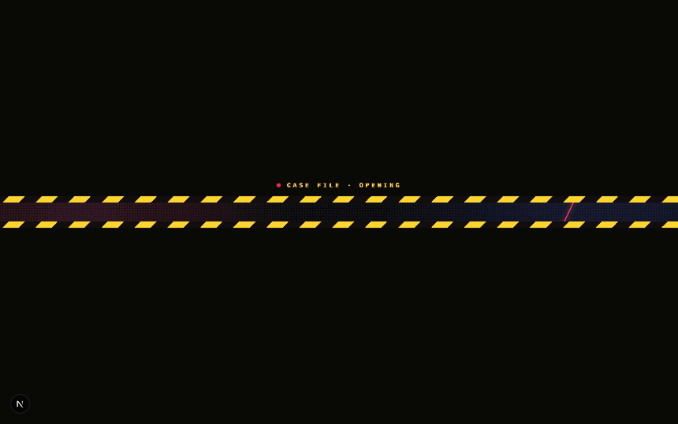
</p>

## What is TruthLens?

Deepfakes and photo edits are now trivial. Detectors that *guess* whether an image is fake are always
one generator behind. TruthLens flips the question: instead of asking *"is this fake?"*, it lets a real
photo **prove where it came from**.

When a photo is taken, it is fingerprinted (SHA-256 + a perceptual hash) and signed by a key that never
leaves the device. The fingerprint is then anchored on a blockchain. Later, anyone can check **any** image,
by uploading the file **or by pointing a camera at it**, and get one of three verdicts:

| Verdict | Meaning |
|---|---|
| ✅ **AUTHENTIC** | Bit-for-bit identical to a sealed photo, with a valid device signature. |
| ⚠️ **EDITED** | Visually matches a sealed original but the bytes differ. A heatmap shows *which regions* changed and by how much. |
| ❌ **UNVERIFIED** | No provenance record. Its origin can't be proven, which is **not** the same as proven fake. |

> **New: live camera verify.** Hold your phone over a photo on someone else's screen or on paper and
> TruthLens finds its sealed original on the ledger in real time: when it was sealed, by which device,
> and the original to compare against. Only 64-bit fingerprints leave the phone, never the picture.
> [How it works →](#live-camera-verify)

> **Honest scope.** TruthLens proves *provenance*: where a photo came from and whether it changed
> since capture. It does **not** run AI deepfake detection, and it cannot prove that the scene in
> front of the camera was real. See [Security & limitations](#security--limitations).

<table>
  <tr>
    <td width="50%">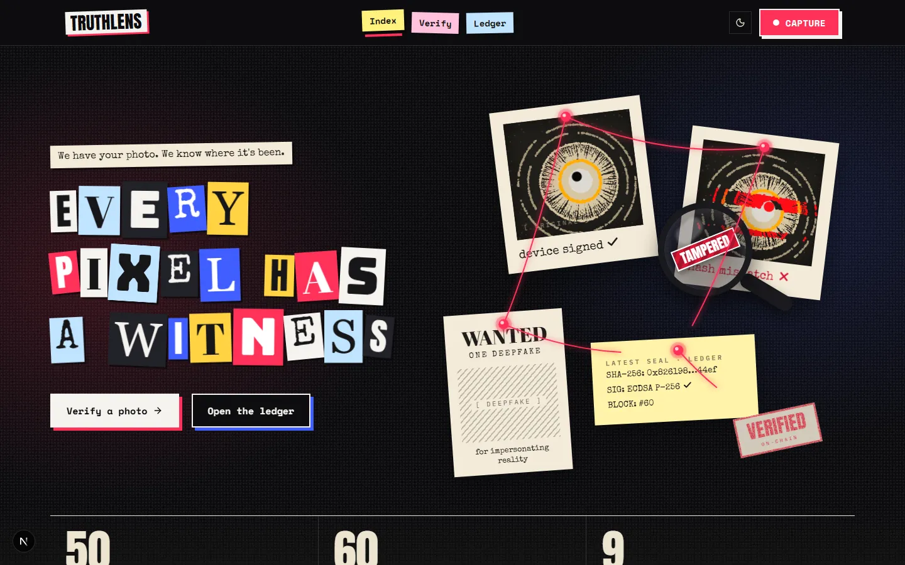</td>
    <td width="50%">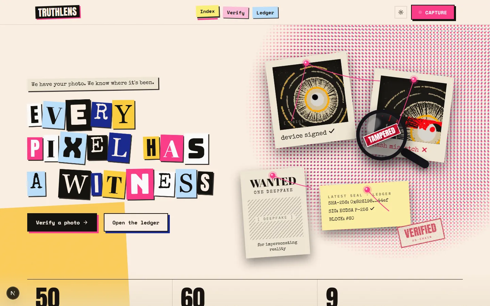</td>
  </tr>
  <tr>
    <td>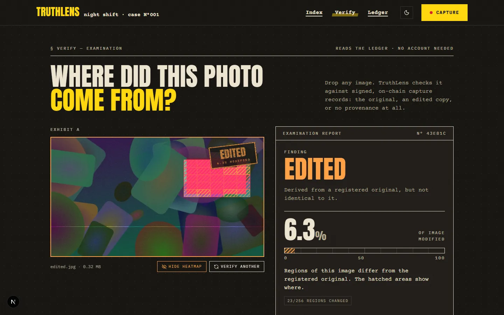</td>
    <td>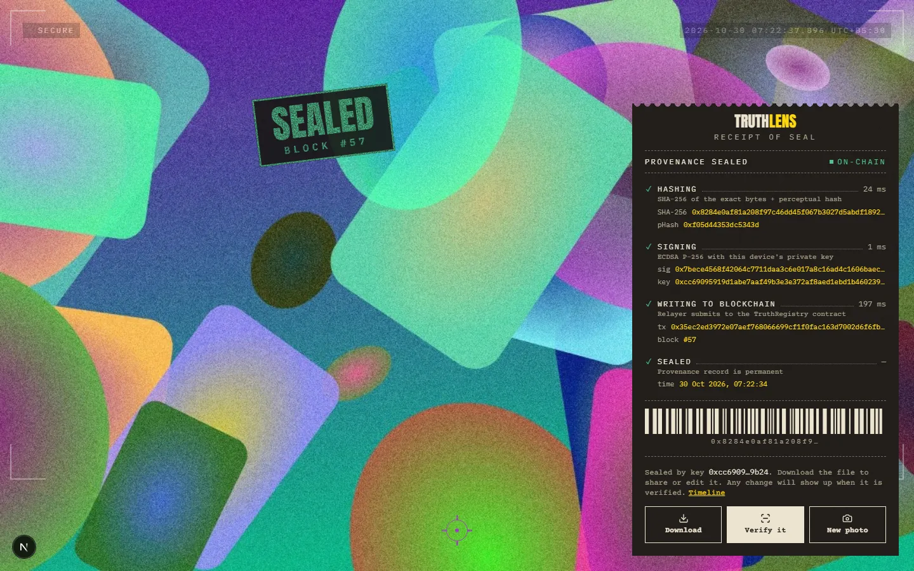</td>
  </tr>
</table>

<details>
<summary>More screenshots (verdicts, timeline, ledger, phone)</summary>

| | |
|---|---|
| 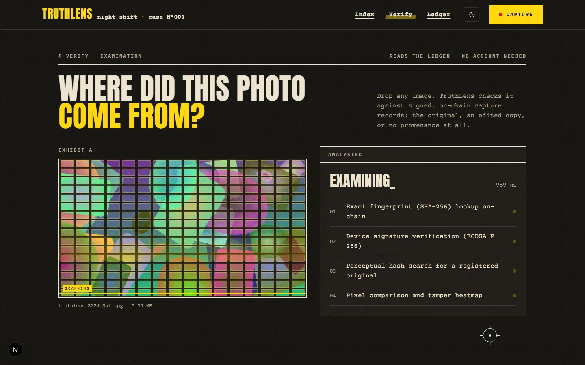 | 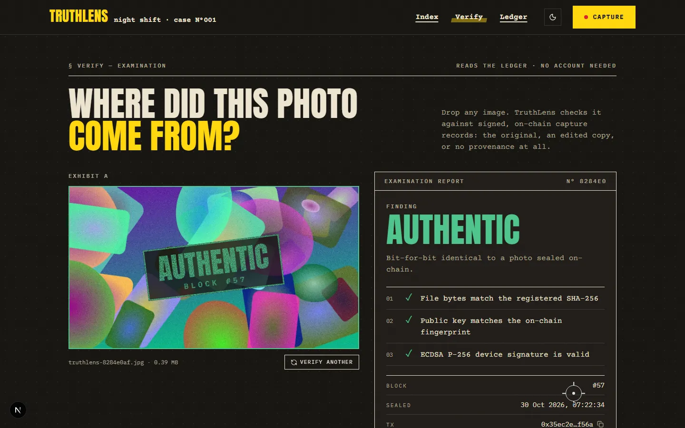 |
| 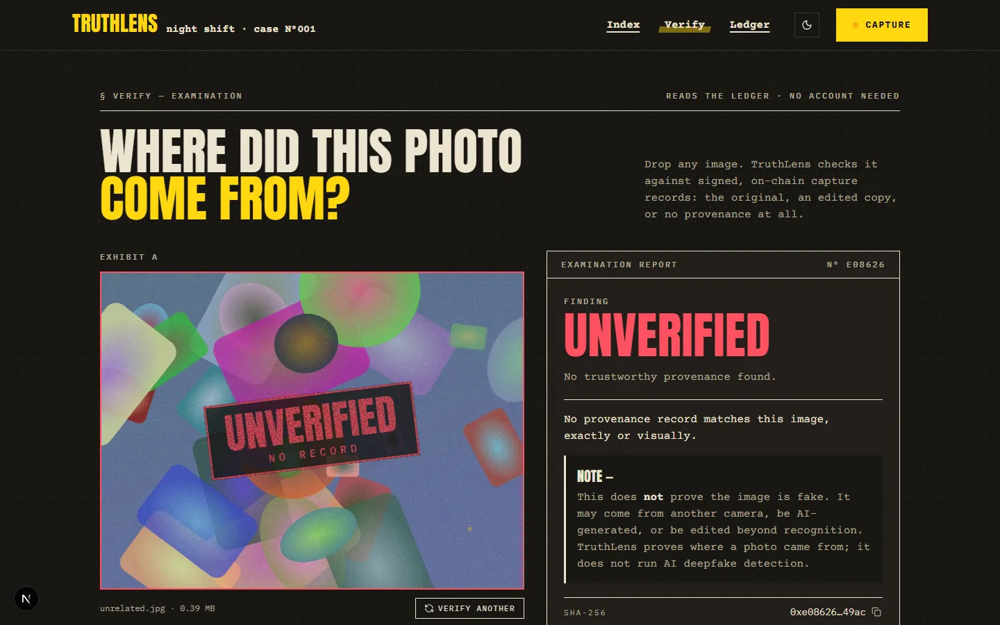 | 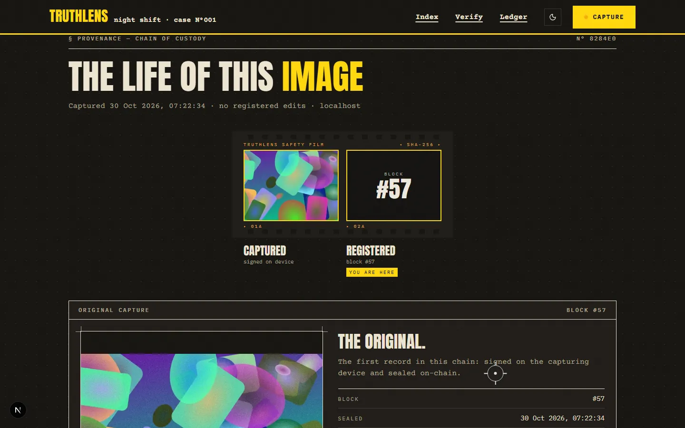 |
| 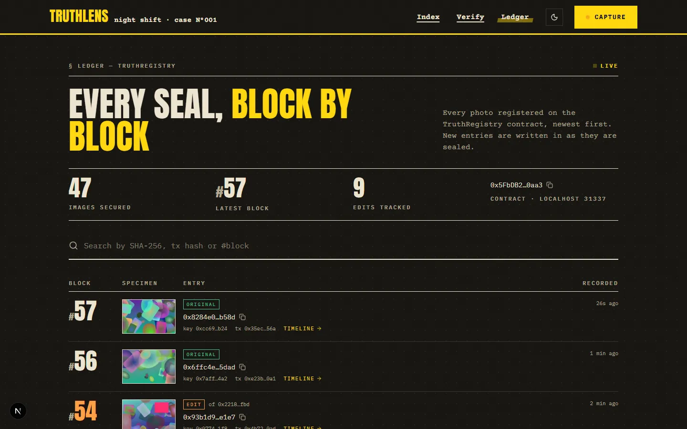 | 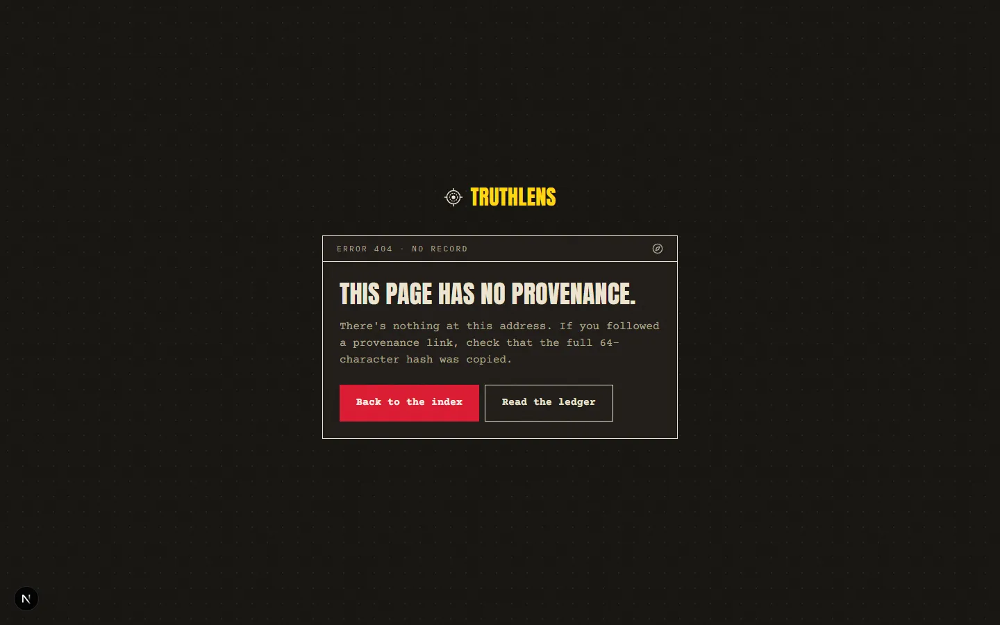 |

<p>
  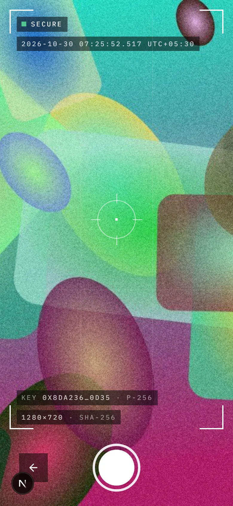
  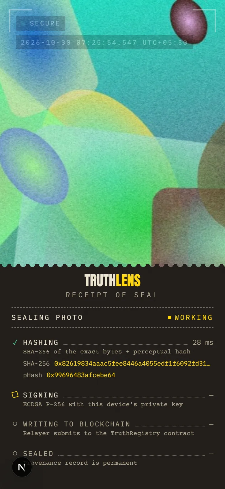
  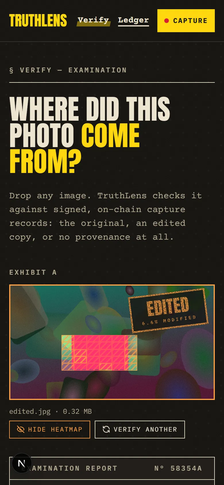
</p>
</details>

## Contents

1. [How it works](#how-it-works) (including [live camera verify](#live-camera-verify))
2. [Design](#design)
3. [Quick start](#quick-start)
4. [Demo script for the presentation](#demo-script-for-the-presentation)
5. [Commands](#commands)
6. [Evidence: tests and measurements](#evidence-tests-and-measurements)
7. [Design decisions & trade-offs](#design-decisions--trade-offs)
8. [Security & limitations](#security--limitations)
9. [API reference](#api-reference)
10. [Project structure](#project-structure)
11. [Troubleshooting](#troubleshooting)
12. [Deploying to Polygon Amoy and S3](#deploying-to-polygon-amoy-and-s3)

Preparing for the viva? See **[docs/VIVA.md](docs/VIVA.md)** for likely questions with short answers.

---

## How it works

### Architecture

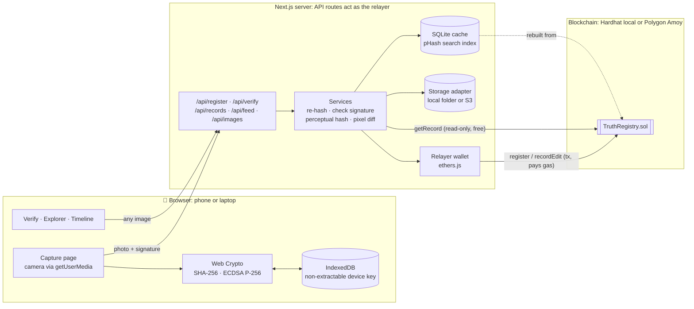

- **On-chain (source of truth):** the SHA-256, the perceptual hash, the SHA-256 of the device's
  public key, a pointer to the stored original, and the chain's own timestamp and block number.
- **Off-chain:** the original image and a `proof.json` (full public key + signature). They can't be
  forged usefully: the key's fingerprint and the image hash are pinned on-chain.
- **The relayer:** the server submits transactions with its own wallet, so users never need a
  crypto wallet or gas. Only allow-listed relayers may write to the contract.

### Capturing and sealing a photo

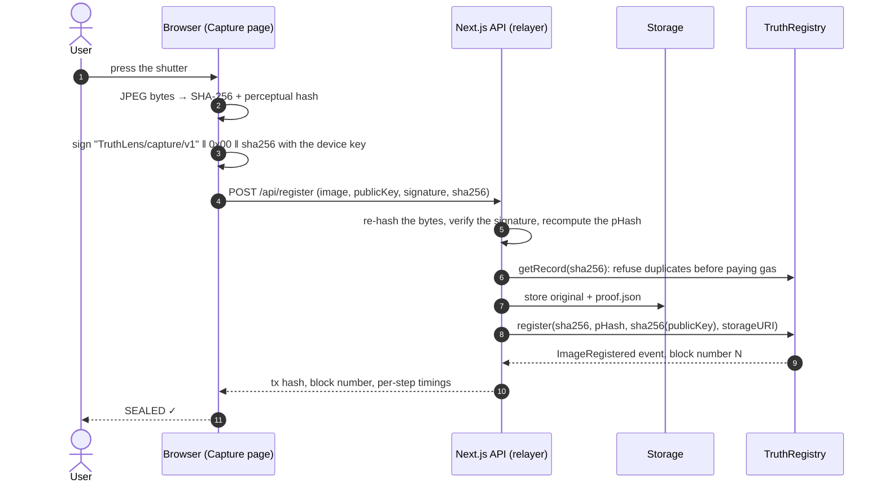

The server trusts nothing the browser claims: it re-hashes the bytes it received and computes the
perceptual hash itself, so a malicious client can't attach someone else's fingerprint.

### Verifying any image

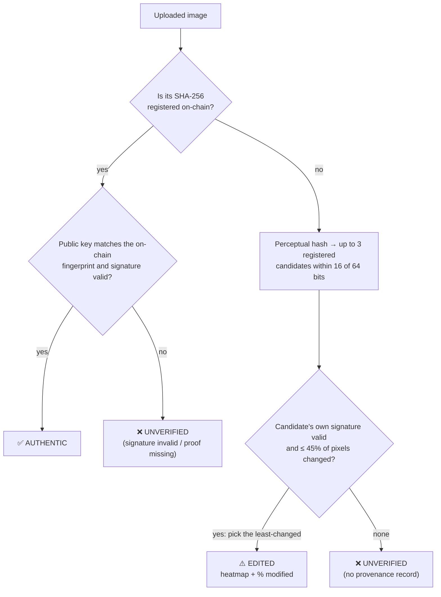

The perceptual hash only *shortlists* candidates; the pixel comparison *decides*. Several sealed
photos can look alike (e.g. a burst of the same scene), so the original that explains the image with
the least change wins.


### Live camera verify

Open **Verify → Live camera** and hold the phone over a photo: on another phone, a laptop screen, a
printout. A few times a second TruthLens looks for that photo's sealed original on the ledger.

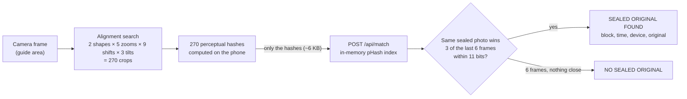

- **Private by design:** the picture never leaves the device; the server only sees 64-bit fingerprints.
- **Why an alignment search?** A re-photographed photo is never framed like the original: there's a
  border, it's off-centre, the phone is tilted. A perceptual hash is very sensitive to framing (10–30
  bits) but barely affected by blur, glare or noise (0–10 bits). So each frame is hashed at 270 crops
  and the best-aligned one counts. That took a realistic re-capture from **0–25% matched to 88–100%**.
- **Stricter threshold than file checks (11 bits, not 16):** 270 tries give an unrelated photo 270
  chances to land close, so the threshold was re-measured: at 11 bits, **0 of 1,440** unrelated pairs
  matched (see [Evidence](#live-camera-verify-11-of-64-bits)).
- **Stable, not flickery:** one frame is noisy (autofocus, a moving hand), so a photo is only *locked*
  when it wins 3 of the last 6 frames.
- **Honest result:** a re-captured photo has new bytes, so live mode can never say AUTHENTIC. It *finds*
  the sealed original; uploading the actual file gives the bit-for-bit verdict.

Code: [`src/lib/live-match.ts`](web/src/lib/live-match.ts) (thresholds, alignment grid, decision),
[`src/lib/client/frame-hash.ts`](web/src/lib/client/frame-hash.ts) (in-browser hashing),
[`src/app/api/match/route.ts`](web/src/app/api/match/route.ts),
[`src/components/verify/live-verify.tsx`](web/src/components/verify/live-verify.tsx).

---

## Design

The visual identity is called **Night Shift**: a detective's evidence board. Condensed headlines,
typewriter text, caution tape, polaroids pinned up and joined with red string, rubber stamps. It
follows the subject (a photo is evidence; TruthLens is its chain of custody) and deliberately avoids
the usual "AI product" look (glass panels, neon glows, gradient text).

- **Two themes**, switched with the moon/sun button in the masthead: **Night shift** (warm near-black
  board, cream ink, caution yellow; the default) and **Day shift** (manila case-file paper, black
  ink, ballpoint blue). The new theme wipes in as a circle from the button (View Transitions API).
  The choice is remembered, and a tiny script in `<head>` applies it before the first paint, so
  there's never a flash.
- **Type:** Anton (tall condensed capitals) for headlines, Courier Prime (a typewriter face, like a
  typed case report) for text, IBM Plex Mono for hashes and data labels. The hero and masthead add
  Abril Fatface, Bungee, Special Elite and Space Mono. All are self-hosted with `next/font`.
- **Colour roles:** `signal` for anything interactive (yellow at night, blue by day), `alarm` red
  for the main button, pins, string and stamps, `tape` yellow for caution tape and the Capture
  button (only ever a background, so it's readable in both themes). Verdicts keep their meaning:
  green (authentic), orange (edited), red (unverified).
- **Masthead and landing hero: "Ransom Note Evidence Board".** These two have their own palette
  (`--rn-*` and `--cut-1..6` in `globals.css`): **Midnight Flash** at night (near-black, red and
  blue glows, a fine white halftone, a camera flash behind the hero every ~5 s) and **Riso Zine**
  by day (cream paper, a pink halftone circle with a blue copy printed out of register that
  wobbles, a yellow block).
  - Masthead: the TRUTHLENS label stuck on at -2°, the links as coloured paper tabs in Space
    Mono (the active one lifted, with a red bar that slides between them), a chunky red CAPTURE button.
  - Headline: **"EVERY PIXEL HAS A WITNESS"** built by `<RansomText>` (`landing/ransom-text.tsx`):
    every letter is a cut-out with its own font (Anton, Abril Fatface, Bungee, Special Elite,
    Georgia), size, paper colour and tilt. All of these are derived from the letter's position,
    never `Math.random()`, so server and browser render identical HTML (no hydration mismatch).
    The letters drop in, then jiggle (CSS, staggered); hovering one pops it straight. The `<h1>`
    has the real sentence as its `aria-label`; the letters are hidden from screen readers.
  - The **evidence cluster**: two polaroids, each holding a live 3D halftone eye (three.js,
    ~11,000 dots). Exhibit A is the clean original ("device signed"). Exhibit B is a suspect copy
    whose eye has red, sliced, glitching bands, under a magnifying glass ("hash mismatch"). A
    **WANTED** poster (one deepfake, for impersonating reality; hidden below 900px). A seal card
    with the **latest real seal** from the chain (hash, signature, block). A **VERIFIED ·
    ON-CHAIN** stamp that thumps every 3 s. **Red string** between glowing pins, endlessly being
    drawn and pulled back. With a mouse, every item can be dragged and thrown around, and the
    strings follow.
  - Below 900px wide, the headline stacks above the cluster.
  - Two crossing caution tapes further down the landing page.
  - Verdicts land as **rubber stamps**; edits are shown with **cross-hatching**; the capture flow
    ends in a printed **receipt** with a barcode from the photo's hash; provenance is a **film
    strip**; the explorer is a **ledger**; the method is four **index cards** pinned to the board; a
    live **ticker** shows new seals.
- **Motion and interaction** (all off with the OS "reduce motion" setting; cursor effects only with a mouse):
  - **Shutter transitions:** every page change snaps open two black blades edged with caution tape
    (`app/(site)/template.tsx`).
  - **Viewfinder cursor:** a focusing ring that follows the mouse, grows over links and shows a
    yellow sticker label ("Seal", "Grill it", "Drag", "Open"...) taken from a `data-cursor`
    attribute (`components/cursor.tsx`).
  - **Draggable evidence board** with live red string (`landing/evidence-board.tsx`).
  - **Magnetic buttons** that lean toward the pointer (`ui/magnetic.tsx`); buttons lift and cast a
    hard yellow shadow on hover.
  - **Ransom headline:** cut-out letters drop in, jiggle, and pop when hovered (`landing/ransom-text.tsx`).
  - **Velocity tapes:** the crossing tapes speed up and their type skews with how fast you scroll
    (`landing/velocity-marquee.tsx`).
  - **Camera flash** behind the hero (night theme). One flash every 5 s is far below the
    3-flashes-per-second photosensitivity limit (WCAG 2.3.1), and it is off with reduced motion.
  - **Parallax hero**, a **scroll-progress rule** under the masthead, **scrambling nav labels**,
    index cards that straighten when hovered, stamps that slam in when scrolled into view, and
    counters that count up on sight.
  - **Forensic loupe:** after a verdict, hovering the exhibit magnifies it ×2.5 (`verify/pixel-stage.tsx`).
  - **Ledger previews:** hovering a row in the explorer floats a tilted preview card of that photo.
  - **Film grain** that flickers slightly, like projected film.

All colours are CSS variables (`--paper`, `--ink`, `--signal`, …) defined once per theme in
`web/src/app/globals.css`, so components never hard-code light or dark.

---

## Quick start

**Prerequisites:** Node.js 22 or newer (developed on Node 25), npm 10+, a webcam for the camera page.

```bash
npm run setup            # install blockchain/ and web/ dependencies (first time only)
```

Then, in three terminals from the project folder:

```bash
# terminal 1: local blockchain (keep it open)
npm run chain

# terminal 2: deploy the contract, then start the app
npm run deploy:local     # needed after EVERY chain restart
npm run dev              # http://localhost:3000

# terminal 3 (optional): sample data so the explorer isn't empty
npm run seed
```

Open http://localhost:3000. Health check: http://localhost:3000/api/health should say `"ok": true`.

Configuration lives in `web/.env.local` (copy of `web/.env.example`). For the local chain it only
needs Hardhat's public test key, which the server refuses to use on any real network.

**Camera on a phone:** browsers only allow the camera on `https://` or `localhost`. On the same Wi-Fi,
run `npm run dev:https` instead of `npm run dev`, open the printed `https://<your-ip>:3000` address
on the phone and accept the self-signed certificate warning. (`npx untun tunnel http://localhost:3000`
gives a public HTTPS link as an alternative.) *Add to Home Screen* installs it as an app that opens
straight into the camera.

---

## Demo script for the presentation

About 8–10 minutes. **Do** is what you click; **Say** is a suggested line.

### The day before

- [ ] `npm run setup`, then run the whole demo once on the presentation laptop.
- [ ] `npm test` and `npm run e2e`: everything green.
- [ ] Record a 2-minute screen capture of the demo as a backup video.
- [ ] Save an image that was **never** sealed (any photo from the internet, or an AI-generated one)
      to the desktop as `unrelated.jpg`.

### 10 minutes before

1. Close other apps that use the camera (Teams, Zoom, the Camera app).
2. Terminal 1: `npm run chain`. Terminal 2: `npm run deploy:local`, then `npm run build` and
   `npm run start` (production mode is faster and shows no dev badges). Terminal 3: `npm run seed`.
3. Open http://localhost:3000/api/health: all five checks `ok`.
4. Open browser tabs: **Index**, **Capture**, **Verify**, **Ledger**. Zoom the browser to ~110% so
   the back row can read it.
5. Open Paint (or any image editor).

### Live

| # | Do | Say |
|---|---|---|
| 1 | **Home.** Move the mouse over the eye; point at the live counters. | "AI can now fake any photo. Instead of guessing what's fake, TruthLens proves what's real: every photo carries a cryptographic record of where it came from." |
| 2 | **Capture.** Point at **● SECURE** and the key fingerprint. | "This browser holds a private signing key that cannot be exported, not even by JavaScript on this page." |
| 3 | Press the shutter (photograph the audience). Narrate the four steps as they animate. | "It hashes the exact bytes, signs the hash with the device key, and the server writes the fingerprint to a smart contract. Sealed in block number N, permanently." |
| 4 | Press **Download** (keep the file for step 7). Switch to the **Ledger**. | "Here's our photo as the newest block on the chain. The counters at the top just ticked up." |
| 5 | Back on Capture, press **Verify it**. | "Verification needs no account and no wallet. It only reads the chain." |
| 6 | **AUTHENTIC**: point at the three checks. | "The bytes match the registered hash, the key matches the fingerprint on-chain, and the signature is valid. Not one bit has changed." |
| 7 | Open the downloaded file in **Paint**, add a sticker or text, **Save as** a new JPEG. Drop it on **Verify**. | "Now I edit the photo, as anyone could before sharing it." |
| 8 | **EDITED**: point at the hatched regions and the stamp, the % ruler, then drag the **before/after slider**. Toggle the heatmap. | "It found the original from what the picture *looks* like, then compared pixels. The tiles light up exactly where I edited: X% of the image." |
| 9 | Drop `unrelated.jpg`. | "And a photo with no history at all…" |
| 10 | **UNVERIFIED**: read the info box aloud. | "Unverified does *not* mean fake. It means no provenance. We're honest about what cryptography can and can't prove." |
| 11 | On the EDITED result, open **The original's provenance timeline** (or the seeded chain from the explorer). | "Every registered edit links back to its original, so a photo's whole history is traceable." |
| 12 | Back to **Home**, scroll to **Honest scope**. | "TruthLens proves provenance, not truth. Paired with trusted capture hardware, it lets anyone check where a photo came from in seconds." |

Optional extras at any point: click the **moon/sun** button in the masthead and the page wipes from
night shift to day shift. On the landing page, **drag the polaroids** around the evidence board and
watch the red string follow.

Optional extra between 8 and 9: send the downloaded photo to yourself on **WhatsApp**, download it and
verify. It shows **EDITED: re-encoded, 0% modified**: same picture, different bytes, because
WhatsApp recompresses images.

### If something goes wrong

| Problem | Recovery |
|---|---|
| Camera won't start | On the camera page choose **Sign a photo file instead** and pick any photo; the rest of the demo is identical. |
| "Blockchain node is offline" | Terminal 1: `npm run chain`; terminal 2: `npm run deploy:local` and `npm run seed` (30 seconds). |
| Pages keep reloading (dev mode) | Stop the app, `npm run clean`, start again. |
| Anything else | Play the backup video; screenshots are in `docs/screenshots/`. |

---

## Commands

All from the project root.

| Command | What it does |
|---|---|
| `npm run setup` | Install both sub-projects. |
| `npm run chain` | Local Hardhat blockchain on port 8545. |
| `npm run deploy:local` | Deploy `TruthRegistry` and write the deployment file the web app reads. |
| `npm run dev` / `npm run dev:https` | Web app in development (HTTPS variant for phones). |
| `npm run build` then `npm run start` | Production build and server (recommended for the presentation). |
| `npm run seed` | Register sample photos, including a two-level edit chain. |
| `npm test` | Contract tests (22) + unit tests (71). |
| `npm run e2e` | End-to-end check of the running system over HTTP (23 checks, attacks included). |
| `npm run ui:check` | Headless-browser walkthrough with a fake camera (`-- --mobile`, `-- --reduced-motion`). |
| `npm run phash:report` | Perceptual-hash robustness table (`-- photo1.jpg photo2.jpg` for your own photos). |
| `npm run diff:report` | Tamper-heatmap calibration table. |
| `npm --prefix web run live:report` | Live camera verify calibration: simulated screen re-captures, alignment search, false-match rate. |
| `npm run gas` | Contract tests with gas usage per function. |
| `npm run smoke:local` | Write and read one record directly on the chain. |
| `npm run clean` | Delete the Next.js build cache (`web/.next`). |

---

## Evidence: tests and measurements

| Suite | What it covers |
|---|---|
| **Contract tests** (22, Hardhat + Mocha) | Registration, duplicate rejection, lookups, pagination, edit chains (multi-level, branches, cycle prevention), relayer access control, ownership. |
| **Unit tests** (71, Vitest) | SHA-256 against NIST vectors and OpenSSL; ECDSA non-extractability, tampering, domain separation, OpenSSL interoperability; pHash robustness and EXIF orientation; device key storage (reload, two-tab race); heatmap accuracy; storage path-traversal safety; the SQLite index; live verify (frame-window decisions, alignment grid, fast Hamming distance, in-memory index cache). |
| **End-to-end** (`npm run e2e`) | Register; duplicate, forged-signature, tampered-in-transit and non-image uploads all rejected; AUTHENTIC / EDITED (re-encoded and modified, with heatmap) / UNVERIFIED; edit chains; live matching from hashes alone (and malformed hashes refused); thumbnails, feed, search, stats. |
| **UI walkthrough** (`npm run ui:check`) | The whole demo in a real browser on desktop, phone size and reduced motion; fails on any browser error; checks the camera is released when you leave the capture page; points a fake camera at the sealed photo on a "screen" (border, tilt, glare, noise) and expects **Sealed original found**, then at an unrelated photo and expects **No sealed original**. |

### Perceptual hash threshold: 16 of 64 bits

Measured with `npm run phash:report` over 8 generated scenes (Hamming distance):

| Transformation | Distance | Matched at 16 |
|---|---|---|
| JPEG q30–q75, resize to 25–50%, WhatsApp-style, double recompress | 0–2 | 100% |
| Brightness / contrast | 0–4 | 100% |
| Saturation / grayscale filters | 0–14 | 100% |
| Pasted object (5% of area), caption text | 4–16 | 100% |
| Pasted object (12% of area) | 10–18 | 75% |
| Region swapped from another photo (25%) | 8–24 | 63% |
| Crop 8% per side | 12–26 | 13% |
| Mirrored | 30–36 | 0% |
| **Unrelated images** | **22–38 (mean 31)** | **0%** |

The match has two jobs: recognise re-shared copies **and** link an edited photo to its original so
the heatmap can be drawn. 16 covers every benign transformation and most realistic edits while
staying 6+ bits below the closest unrelated pair.

### Live camera verify: 11 of 64 bits

Measured with `npm --prefix web run live:report`: 16 sealed photos (8 at 4:3, 8 at 16:9) shown on a
simulated screen and re-captured, with the alignment search (270 crops per frame):

| Simulated re-capture | Plain hash, matched | With alignment search |
|---|---|---|
| Photo fills 96% of the guide, centred | 50% | 100% (distance 2–6) |
| Fills 85%, off-centre | 0% | 100% (2–6) |
| Fills 75%, centred | 0% | 100% (2–8) |
| Fills 88%, tilted 2° | 0% | 94% (4–12) |
| Realistic: off-centre + tilt + blur + glare + dimming + sensor noise | 0% | 88–100% (2–12) |
| **Unrelated photos** (1,440 frame/photo pairs) | | **0% matched** (closest: 12 bits) |

| Threshold | True frames matched | False frames matched |
|---|---|---|
| 10 | 97% | 0% |
| **11 (used)** | **97%** | **0%** |
| 12 | 100% | 0% |
| 16 (the file-check threshold) | 100% | 1% |

A lock needs the same photo in 3 of the last 6 frames, so a 97% per-frame hit rate locks almost
immediately, while a stray close frame from an unrelated photo can never lock on its own.

### Tamper heatmap

Pipeline: resize both images to 512 px wide → grayscale + slight blur (removes JPEG artefacts) →
**robust brightness/contrast fit** (start from quantiles, then least squares on agreeing pixels only,
so a whole-image filter is undone while local edits stay visible) → pixels differing by more than
20 levels count as changed → summarised on a 16×16 grid. Measured with `npm run diff:report`:

| Transformation | Reported as modified |
|---|---|
| Recompress (q30–q75), resize (25–50%), WhatsApp-style | 0.0–0.3% |
| Brightness / contrast / saturation / grayscale | 0.0–0.2% (flagged as a *global adjustment*) |
| Caption text added | 2.3–2.7% |
| Pasted object, 5% / 12% of the area | 2.3–5.2% / 10.9–12.3% |
| Region swapped from another photo (25%) | 15.2–22.8% |
| Crop 8% per side | 24.9–31.2% |
| **Unrelated image** | **52.8–59.1%** → above the 45% "not a derivative" cut-off |

### Gas (from `npm run gas`)

| Operation | Gas used |
|---|---|
| `register` (seal one photo) | 172,000–192,000 (varies with the storage URI length) |
| `recordEdit` (link an edit) | 85,000–102,000 |
| Deploy `TruthRegistry` (once) | 1,685,403 |
| Verify / read anything | 0: read-only calls are free |

Cost = gas used × gas price. For example, at a gas price of 30 gwei one registration costs about
175,000 × 30 gwei ≈ 0.005 POL. (Real prices on Polygon vary.)

---

## Design decisions & trade-offs

### Blockchain

| Decision | Why |
|---|---|
| Only hashes on-chain, never the image | Blockchain storage costs gas per byte, and photos can be private. A 32-byte SHA-256 commits to the exact bytes just as strongly. |
| Public-key fingerprint on-chain; signature + full key off-chain | Keeps each record small. The on-chain fingerprint pins the key, so the off-chain copy can't be swapped. |
| Relayer allow-list | Users need no wallet. Without it, anyone could register a hash first under a fake key ("squatting"). |
| Duplicates rejected | The first registration *is* the provenance claim; overwriting it would destroy the proof. |
| Edit links: both registered, one parent, edit after original | Every node in a chain is itself signed; the "after" rule makes cycles impossible. |
| Timestamp and block number set by the contract | Clients can't backdate a photo; the chain's clock is the trusted one. |
| `getHashes(start, count)` pagination | Public RPCs limit event-log queries; the cache can be rebuilt from contract state instead. |

### Cryptography

| Decision | Why |
|---|---|
| ECDSA **P-256** (not Ethereum's secp256k1) | Supported natively by Web Crypto, phone secure enclaves and passkeys, so the key can stay non-extractable. |
| Non-extractable key in IndexedDB | Scripts can sign with it but never read or copy it. |
| Domain-separated message `"TruthLens/capture/v1" ‖ 0x00 ‖ sha256` | A TruthLens signature can't be replayed as a signature over anything else. |
| DCT perceptual hash (not dHash) | JPEG also works in DCT space, so pHash is more stable under recompression. |
| Server recomputes SHA-256 and pHash | Never trust the client: a lying client could claim another photo's pHash. |

### Backend

| Decision | Why |
|---|---|
| Next.js route handlers as the relayer | One codebase and deployment for UI and API. |
| Storage written before the chain | A failed transaction leaves a harmless orphan file; the reverse could leave a record pointing at nothing. |
| Storage adapter: local folder or S3 | Local for development; S3 for hosting (serverless disks are temporary). Reads follow each URI's own scheme. |
| SQLite cache via Node's built-in `node:sqlite` (not Prisma) | One table, no code generation, no native driver. It's only a cache: rebuilt from the chain and self-healing after a chain reset. |
| Serialised transactions + nonce manager | Concurrent registrations would otherwise collide on transaction numbers. |
| Per-IP rate limit (10/min) on registration | Each registration costs gas; an open endpoint could drain the relayer. |
| Upload checks: 15 MB, format detected from content, 50 MP decode cap | Rejects disguised files and "decompression bombs". |
| Thumbnails only at 160/320/640 px | Arbitrary sizes would let anyone make the server burn CPU. |

### Frontend

| Decision | Why |
|---|---|
| Animate only transform/opacity; ambient effects in CSS | Runs on the GPU compositor, so 256 tiles + laser stay smooth. |
| 3D eye in one GPU shader; client-only; pauses off-screen | ~11,000 halftone dots without CPU work per frame, coloured from CSS variables set on the polaroid (a fixed "film" palette); no WebGL → a static printed mark. |
| Red string measured from the DOM every frame | The pins' real positions (after rotation, dragging and springs) are read with `getBoundingClientRect` and the SVG path is written directly, so the string never detaches and React never re-renders. |
| Dragging only with a mouse | On touch screens, draggable cards would block page scrolling, so the board stays still there. |
| Theme in `<html data-theme>` + an inline `<head>` script | Applies the saved/OS theme before first paint, so there's no flash of the wrong theme. |
| Design tokens as CSS variables per theme | One source of truth; components never branch on light/dark. |
| Theme switch via the View Transitions API | A circular wipe from the toggle; instant switch where unsupported or with reduced motion. |
| Reduced motion respected everywhere | Framer Motion + CSS media query; the 3D hero becomes one still frame. |
| Pointer effects write styles directly (no React re-render per mouse move) | Cursor, magnetic buttons, headline letters and loupe use motion values or `requestAnimationFrame`, so they stay at 60 fps. Touch devices never get them. |
| Custom cursor only for a fine pointer (mouse) | Phones and tablets keep native behaviour; text inputs keep the normal text cursor. |
| Real timings in the sealing animation | Steps have a minimum display time, but the milliseconds shown are real. |
| Live verify hashes in the browser, sends only hashes | ~6 KB of JSON per frame instead of a photo upload, and the picture stays private. The server compares 270 hashes against an in-memory copy of the index with a 32-bit popcount (no BigInt, no database read per frame). |
| Server-rendered first paint, then polling | No "0" flash for counters; polling only while the tab is visible. |
| Fixed `en-GB` date format | Server and browser must render identical text (hydration). |
| Turbopack's on-disk dev cache disabled | Most likely cause of an endless reload loop seen twice after the dev server was killed mid-write; reliability matters more than startup time. |

---

## Security & limitations

| Threat | Mitigation | What remains |
|---|---|---|
| Editing a sealed photo and passing it off as original | SHA-256 changes completely; verdict becomes EDITED with a heatmap. | — |
| Forging a signature / swapping the stored key | Signature checked against the actual bytes; the key's fingerprint is on-chain. | — |
| Registering someone else's photo first | Only allow-listed relayers write; the relayer requires a valid device signature. | A thief can sign a copy with *their own* key; first-come wins. |
| Tampering in transit | The server re-hashes the bytes and compares with the hash the device signed. | — |
| Draining the relayer's gas | Per-IP rate limit; duplicates rejected before paying gas. | In-memory limit is per server instance. |
| Photographing a screen showing a deepfake ("analog hole") | — | **Not prevented.** Provenance proves *who sealed what, when*, not that the scene was real. Trusted camera hardware (e.g. C2PA cameras) narrows this. |
| A compromised device signing fake content | Key can't be copied off the device. | Malware *on* the device can still use it. Hardware attestation (Android Key Attestation, iOS App Attest) is future work. |
| AI-generated images | Shown as UNVERIFIED (no record). | No AI classifier, by design. |
| Heavy crops, mirroring, hue-only edits | Documented measurements. | May show as UNVERIFIED or under-reported. Feature matching (ORB/SIFT) is future work. |
| Privacy | Only hashes on-chain. | Originals are publicly readable in this demo; the key fingerprint links photos from the same device. |
| Centralised relayer | Can't alter past records; anyone can read and verify the chain independently. | The relayer decides what gets *written*. |

---

## API reference

| Route | Purpose |
|---|---|
| `POST /api/register` | `image`, `publicKey`, `signature` (+ optional `sha256`, `parentHash`) → 201 with record, tx hash, block, per-step timings. |
| `POST /api/verify` | `image` → `AUTHENTIC` / `EDITED` (heatmap, % modified, original) / `UNVERIFIED` (reason). |
| `GET /api/images/:sha256` | Stored original (`?w=160\|320\|640` for a WebP thumbnail). Cached forever: content-addressed. |
| `GET /api/records/:sha256` | Provenance tree: up to the original, then down through every edit. |
| `GET /api/feed?limit&before&q` | Recent registrations; search by hash prefix, tx hash or `#block`. |
| `GET /api/stats` | Images secured, latest block, edits tracked. |
| `GET /api/health` | Chain, contract, relayer, storage and index checks. |

Errors always look like `{ "error": { "code": "SIGNATURE_INVALID", "message": "…" } }`.

---

## Project structure

```
blockchain/                    Hardhat 3 project
  contracts/TruthRegistry.sol    the on-chain provenance registry
  test/TruthRegistry.ts          22 contract tests
  scripts/deploy.ts              deploys and writes the deployment file (also copied into web/)
web/                           Next.js 16 (App Router) + TypeScript + Tailwind v4
  src/app/                       pages: / , /capture, /verify, /explorer, /provenance/[sha256]; api/ routes
  src/components/                capture/, verify/, landing/, provenance/, explorer/, ui/
  src/lib/crypto/                hashing + signing (runs in browser AND server)
  src/lib/image/                 decoding (sharp / canvas) and the tamper heatmap
  src/lib/server/                chain client, storage adapters, SQLite index, services
  src/lib/client/                browser helpers: API calls, camera hook, formatting
  test/                          62 unit tests + seeded photo-like test scenes
  scripts/                       e2e, ui-check, seed, phash/diff reports, icons
docs/
  screenshots/                   images used in this README
  VIVA.md                        likely viva questions with answers
```

The two halves are separate npm projects on purpose (Hardhat 3 is ESM-only with its own TypeScript
settings). They share exactly one thing: the deployment file (contract address + ABI).

---

## Troubleshooting

| Symptom | Fix |
|---|---|
| Pages keep reloading by themselves in `npm run dev` | Stop the dev server, `npm run clean`, start again. |
| "Another next dev server is already running" | An old dev server is still alive: `taskkill /PID <pid> /F` with the PID it prints. |
| "Blockchain node is offline" | `npm run chain`, then `npm run deploy:local` (needed after every chain restart). |
| Camera page says "needs a secure connection" | Use `http://localhost:3000` on the laptop, or `npm run dev:https` for a phone. |
| iPhone photo won't load on Verify | HEIC isn't supported by most browsers: export as JPEG, or set the camera to "Most Compatible". |
| Slow installs / `EPERM` errors | The project is inside OneDrive; moving it to e.g. `C:\dev\truthlens` avoids sync interference. |
| `429 RATE_LIMITED` | More than 10 registrations in a minute from one IP; wait a minute. |

---

## Deploying to Polygon Amoy and S3

1. `cp blockchain/.env.example blockchain/.env`, then set `AMOY_RPC_URL` and `DEPLOYER_PRIVATE_KEY`
   (a throwaway wallet funded from https://faucet.polygon.technology).
2. `npm --prefix blockchain run deploy:amoy`. This writes `deployments/amoy.json` and copies it into the web app.
3. In `web/.env.local` set `CHAIN_NETWORK=amoy`, `RPC_URL` to the Amoy RPC, and `RELAYER_PRIVATE_KEY`
   to the deployer key (the deployer is automatically a relayer). Transactions then link to
   amoy.polygonscan.com.
4. For hosting, store originals in S3: `STORAGE_DRIVER=s3`, `S3_BUCKET`, `AWS_REGION` and AWS credentials.
